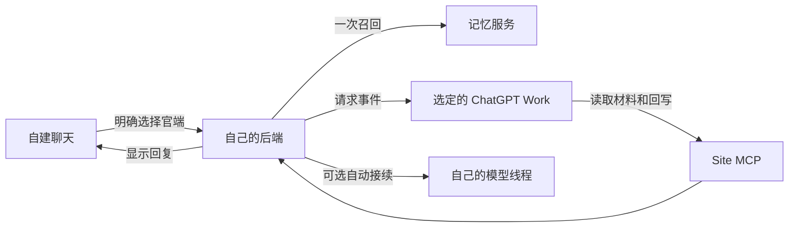

# ChatGPT Context Bridge

让自建聊天前后端把选中的消息、最近对话和召回记忆交给官方 ChatGPT Work，再把回复接回自己的聊天界面。

这是一个中文教程仓库，整理自已跑通的链路。仓库提供实施说明、虚构的 JSON 示例和验收清单；具体后端、记忆服务和原生模型适配由你的项目实现。

## 完整链路

后端冻结最近十轮对话和一次记忆召回。事件只通知请求编号，Work 用 `get_request` 读完材料，再用 `reply` 回写。小材料只携带原始 JSON，大材料分页，正文只保留一种表示。

**十轮不是固定二十条消息。** 连续发送和分气泡回复可能让一轮包含多条。官端也不会自动读取你的记忆库；需要后端实际检索并带入结果。

## 从这里开始

| 文档 | 解决什么 |
| --- | --- |
| [Sites 直接部署 MCP](docs/sites-mcp.md) | 从只读工具开始，部署并连接 Site 配套插件 |
| [Site 接入自建后端](docs/sites-setup.md) | 连接自己的服务，配置认证和准备状态 |
| [完整指南](docs/guide.md) | 从明确选择、上下文和记忆，到配对、回写与自动接续 |
| [脱敏最小示例](examples/README.md) | 离线代码与六份 JSON，展示材料和回复的关联 |
| [验收清单](docs/acceptance.md) | 区分目录连通、材料完整和真实端到端成功 |
| [常见问题](docs/faq.md) | 重复上下文、当前指令、分页、准备状态与旧 CLI |

建议按表格顺序阅读，然后把[实施需求](docs/guide.md#11-可以交给施工助手的需求)交给你的开发助手，结合现有工程实现。

## 适用范围

你需要有自己的聊天前后端和记忆检索能力，并能使用支持 MCP Events 的 Work 入口。官方文档当前要求 MCP 2.0，协议版本 `2026-07-28`；支持 Work 网页版与桌面端 Cloud 等入口，具体可用性还受账户和工作区策略影响。[官方 MCP Events 文档](https://developers.openai.com/plugins/build/mcp-events)

最近十轮、配对票据、绑定版本、`get_request` 和 `reply` 是本教程的业务设计。它们需要自己实现，并非平台自动提供。可选的 VPS 自动接续也需要自己的持久队列和运行时适配。

本文档中的地址、消息、记忆和标识均为虚构示例。平台字段与本教程自定义字段的区别见[示例说明](examples/README.md)。

文档核对日期：2026-10-04。
