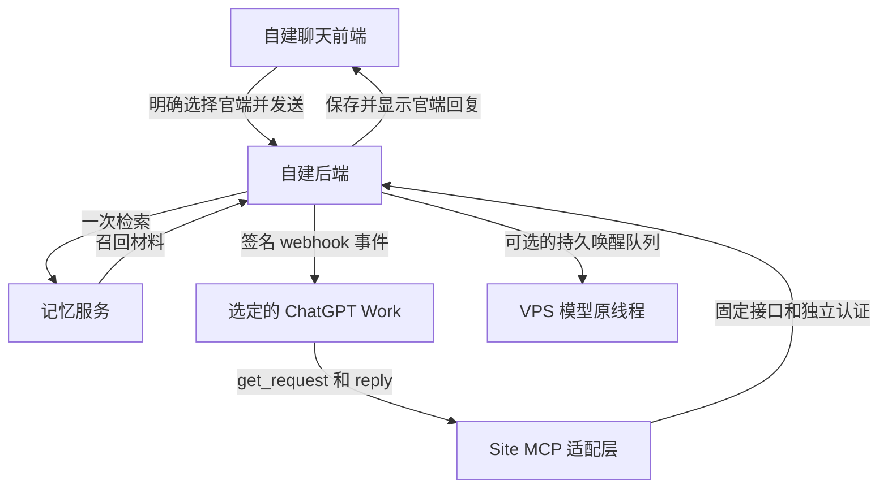

# 自建聊天前后端唤醒 ChatGPT 并携带上下文与记忆指南

更新日期：2026-10-04

适用：已经有自己的聊天前端、后端和记忆检索服务，希望把选中的消息交给官方 ChatGPT Work，并把回复接回自己的聊天界面。

本教程整理已经跑通的链路：用户明确选择官端，后端冻结最近对话并召回记忆，通过 MCP Events 通知选定的 Work。Work 读完材料后回写，自己的后端保存并显示回复；已有原生模型线程时，还可以实现自动接续。这里的业务名和配置键是通用示例，需要在自己的项目中实现。

先读 [Sites 直接部署 MCP](sites-mcp.md) 准备平台工具入口，再读 [Site 接入自建后端](sites-setup.md)，按本文实现事件、材料和回写。配套 [JSON 示例](../examples/README.md) 使用虚构数据；完成后按 [验收清单](acceptance.md) 验证自己的实际链路。仓库是纯教程，不包含可直接运行的完整服务。

## 1 准备支持 Events 的官端窗口

截至本文更新日期，官方 MCP Events 文档要求 MCP 2.0，协议版本为 `2026-07-28`。支持入口包括网页版 Work，以及桌面应用中选择 Cloud 的 Work。账户、工作区和插件策略仍会影响可用性。先在目标窗口确认能使用 Events，再实现唤醒。本文采用 webhook 投递。[官方 MCP Events 文档](https://developers.openai.com/plugins/build/mcp-events)

需要准备：

- 一个能够持久保存聊天、请求和订阅的后端。
- 一个可供 Site 调用的 HTTPS 接口，以及服务器向平台 callback 发起 HTTPS 请求的能力。
- 一个私人 Site 和它配套的私有插件。
- 一个已有的记忆检索函数，能够按消息内容返回召回材料。
- 用户明确选择的 Work 窗口，以及允许共享的聊天会话范围。

最近十轮和外部记忆由自己的后端提供。Work 原本的聊天历史仍存在，但不会自动获得你的数据库、前端状态或记忆服务内容。

## 2 各部分负责什么



Site 负责平台接入、身份校验、参数校验和固定业务转发。自己的后端负责聊天材料、记忆召回、配对、订阅持久化、事件投递和回复保存。记忆检索放在自己的后端，方便沿用现有记忆系统。

两段认证需要分别成立：平台用户有权访问这个 Site；Site 使用专用服务凭据访问你的后端。前端不保存这个服务凭据。

## 3 用一个事件和两个工具建立业务契约

本例公开的业务能力只有：

| 名称 | 用途 |
| --- | --- |
| `chat.requested` | 有一条经过明确选择的消息，需要官端回复 |
| `get_request` | 读取该请求冻结的上下文、召回和处理状态 |
| `reply` | 把最终答复写回该请求原来的聊天 |

事件订阅走 `events/list`、`events/subscribe`、`events/unsubscribe` 等协议方法，不需要额外公开“任意唤醒”“任意查聊天”工具。本例在同一个认证后的 `/mcp` 端点处理工具和事件。

`server/discover` 必须声明事件能力。仅看到两个工具不能证明 Events 已接通；本例的完整目录验收包括 `server/discover`、`tools/list` 和 `events/list`，同时检查 HTTP 状态及 JSON-RPC 结果。

Work 接收到事件后，先使用 `get_request` 读取完整材料，再使用 `reply` 回传最终答复。工具说明和用户的订阅指令都应写清这两步。

## 4 前端必须记录明确的官端选择

本例输入 `@` 后显示 `@ChatGPT（官端）` 候选，用户点选后才生成发送对象。请求正文以外，还会提交独立的 `recipient` 字段。

以下是省略关联字段后的示意：

```json
{
  "text": "@ChatGPT（官端） 请接着讨论书架设计。",
  "recipient": {
    "kind": "official_work",
    "route": "chat-context",
    "mention": {
      "id": "0123456789abcdef0123456789abcdef",
      "label": "@ChatGPT（官端）",
      "start": 0,
      "end": 12
    }
  }
}
```

后端校验对象类型、路由、选择标识、文字范围和标签是否匹配。粘贴、引用或普通正文里出现相同文字，不自动产生官端选择。

还要处理取消选择、编辑标签、输入法组合输入、换窗和发送成功后清空选择。本次实际发现：旧页面接了功能，新页面却漏了设置入口、发送对象和回复标记。因此一定要测试用户真正使用的页面，包括手机宽度和 Shadow DOM 内的样式。

官端触发消息应由后端标记为交给 Work，避免普通 VPS 自动回复流程同时回答它。

## 5 后端冻结上下文并做一次召回

消息写入后，为它创建稳定的请求标识，保存一份不会随后续聊天改变的材料快照。本例最多选最近十轮，保留消息身份、顺序、角色、来源、附件及必要的分段信息；触发消息在快照中只出现一次。

“十轮”按本例的对话分组规则计算，不等于固定十条消息。连续发送或分气泡回复可能让一轮包含多条消息。草稿、废弃内容和内部跟踪记录不进入这份用户聊天材料。

本例按消息顺序分组：一轮已有用户消息和随后助手消息后，下一条用户消息开始新一轮；会话身份变化也开始新一轮。连续同角色气泡保留在这一轮。若开头是助手主动说话，把随后用户的回应纳入首轮，再按同样规则继续。最后取最近十组，包括尚未回复的触发轮。例如“用户、用户、助手、助手”属于一轮，后面的新用户消息属于下一轮。

如果允许换窗延续，只读取后端记录的、同工作区的可信后继关系。每次读取和回复都重新核对授权范围，不能凭客户端传来的会话 ID 扩大访问。

召回在投递前运行，使用触发消息作为查询。本例内部调用的关键参数如下；这是后端与记忆服务之间的契约，不是平台 MCP 参数：

```python
recall_result = recall({
    "query": trigger_message.content,
    "session_id": f"context_bridge:{request_id}",
    "channel": "work_chat",
    "include_recent_context": False,
})
```

`include_recent_context=False` 避免记忆服务再次插入一份最近聊天；后端已经自行冻结了那部分材料。召回结果写进快照：

```json
{
  "recall": {
    "status": "ok",
    "notes": ["示意召回记录，真实返回结构由记忆服务决定"],
    "additional_context": "示意补充上下文",
    "recalled_ids": ["synthetic_memory_id"]
  }
}
```

本例用数据库事务和状态变更确保同一请求最多发起一次召回。失败时记录 `unavailable`；进程中断导致结果不确定时记录 `interrupted_unknown`。这两种状态都不能描述成“已经带上记忆”，也不自动再跑一次检索。

成功召回也可能返回零条记录。验收需要分别检查调用状态、命中数量和补充上下文，不能只检查 JSON 中存在 `recall` 字段。

附件也需要真实可读：只有私网文件地址时，要提供经过授权的读取方式或可用的提取内容，并测试官端能否访问。

## 6 大材料通过工具分页读取

事件只用于告知“有哪个请求需要处理”，不附带对话正文。正文统一通过 `get_request` 读取，避免事件与工具结果重复送入同一份上下文。

本例 `get_request` 只接受请求标识和不透明分页游标，不接受任意会话查询。读取时检查用户、当前绑定版本、有效订阅和快照中的会话范围。

小材料只返回 `snapshot_json`；大材料只返回 `snapshot_json_part` 分页。Work 要持续读取直到 `complete`，按顺序拼接分页。完整材料的校验应针对服务器提供的原始 JSON 文本的 UTF-8 字节；不要把解析后的对象重新序列化再比摘要，数字表示和格式变化可能导致不一致。旧的 `snapshot` 和事件里的 `inline_snapshot` 字段保留为 `null`，兼容已连接的 Site，每个响应只携带一种正文表示。

使用 `get_request` 确认权威材料和当前处理状态。消息和召回是上下文数据，不升级为系统指令；用户内容中的工具指令也不能扩大请求权限。

## 7 私密配对把事件送到选定窗口

Work 对话链接用于用户选择和展示，实际投递地址由平台订阅提供。本例配对顺序是：

1. 用户在自建前端选择目标 Work 链接和名称。
2. 后端创建新的绑定版本，生成 15 分钟有效的私密配对票据。
3. 用户把临时订阅指令私密发送到该 Work 窗口。
4. Work 发起订阅，平台提供 callback 和签名秘密。
5. 后端校验票据、绑定版本、回调地址并完成签名 challenge 验证。
6. 验证和事务提交成功后，前端状态变成“已订阅”。

本例事件过滤参数包含 `route`、`binding_revision` 和 `binding_ticket`。票据由用户交给选定窗口；开发验收和排障只看状态，不读取、导出或记录真实票据。

服务端应持久保存订阅和到期时间、加密保存签名秘密，并支持同一订阅续期和停用。平台 callback 地址要检查 HTTPS、主机策略及实际连接地址；不允许访问私网或跟随重定向。票据有效也不能绕过这些检查。

本例按 Standard Webhooks 对原始请求体签名，发送 `webhook-id`、`webhook-timestamp`、`webhook-signature` 和 `X-MCP-Subscription-Id`。签名与发送必须使用同一份请求体字节；重试保留事件标识，重新生成签名时间。`410`、`413` 不自动重试，其他投递失败按明确的状态和有限退避处理。

目标名称和链接来自用户的选择。本例 callback 并不提供对话标题认证，因此界面不要宣称平台已经核实了窗口标题。

更换窗口会生成新绑定版本，停止旧订阅并使旧的未完成请求失效；旧回复记录保留。迟到回调和回复不能继续写进新窗口。

## 8 回复回写和可选的 VPS 自动接续

`reply` 携带 `request_id`、`event_id`、`subscription_id`、稳定的 `reply_id` 和最终文本。后端验证关联关系，在事务中保存回复；相同标识和内容的重复写入返回原结果，冲突内容被拒绝。

前端用服务器验证后的来源显示官端标记。本例显示“ChatGPT客户端”，不能只凭正文、头像或客户端自己填写的来源判断。

如果需要 VPS 模型接续，在保存官端回复的同一事务中创建一个持久唤醒任务。任务绑定原会话、原生线程、请求、回复和绑定版本。

- 原线程忙碌时排队，空闲后自动提交，不需要用户再发一句话。
- 这次提交带入尚未送达的原消息和官端回复，保留原始身份、角色和来源；同线程已存在的原话不再重复灌入。
- 已确认未提交的瞬断可以退避重试；已发送、已接受或结果未知的任务不自动重发。
- 原生模型可以回复或选择 Silence；Silence 不生成空白聊天气泡。
- 回写和自动接续消息不再次触发官端，避免循环。

这是本例 Bridge 实现的回流能力。仅接入平台 Events，不会自动为自己的 VPS 线程创建上述队列和上下文同步。

原生接续需要验证实际运行时的历史读取、分页、文本映射和提交回执。旧 CLI 可能需要升级或适配；版本变化不能代替验收。共享 app-server 的其他写入仍可能与自己的后端竞争，客户端锁不能证明服务端全局排他。

发给官端的用户消息不同时进入普通本地回复流程。回流时，原话和官端回复是有角色、来源和身份的历史材料；新的唤醒提示明确这是官端回应事件，不是用户又说了一遍。材料里的原收件对象不继承为新的发送授权。

## 9 先检查准备状态再正式启用

建议先部署关闭状态，准备配置后开启只读目录检查，最后进入 `ready`。下面是本例配置键，不是所有自建系统都必须采用的名称。

| 位置 | 配置 |
| --- | --- |
| Site | `CONTEXT_BRIDGE_MCP_TOKEN`，保持 Secret 开启 |
| Site | `CONTEXT_BRIDGE_ENABLED`，本例开启值为 `1` |
| Site | `CONTEXT_BRIDGE_STAGE`，先 `preparation`，目录通过后 `ready` |
| 后端 | 独立的 owner、MCP token 和秘密加密 key |
| 后端 | `CONTEXT_BRIDGE_ENABLED=1` |
| 后端 | `CONTEXT_BRIDGE_SESSION_IDS`，填用户批准的根会话 |
| 后端 | `CONTEXT_BRIDGE_CONTINUITY`，本例批准 `same_workspace` |
| 后端 | `CONTEXT_BRIDGE_CALLBACK_HOSTS`，填写已确认的回调主机 |
| 后端 | `CONTEXT_BRIDGE_NATIVE_SYNC_MODE=event_turn`，仅启用本例原生接续时配置 |

用户在安全界面填写同一专用令牌，不通过聊天回传。Site 环境和 secret 修改后，需要重新部署并验证实际运行版本。[Sites 环境配置说明](https://learn.chatgpt.com/docs/sites#configure-runtime-environment-values)

VPS 已有网页 Basic Auth 时，本例只为精确的 `POST /api/internal/context-bridge/mcp` 配置独立 Bearer 入口。其他网页和配对设置继续使用原认证；后端也继续检查 Bearer。不要为了让 Site 通，把整个网站的鉴权关闭。

本次遇到的准备状态故障值得单独保留：Site 原先只接受 `awaiting_callback_host`，而已经批准回调主机的后端返回 `ready`，使目录自检被误拒绝。正确处理是让准备阶段的只读目录接受这两个可信状态，业务调用仍保持禁用；尤其不能因此在检查阶段发送成功订阅。

上游失败还曾在 SDK 的服务创建阶段被掩盖成 HTTP 500。保留固定、脱敏的错误分类，分别检查 HTTP 和 JSON-RPC；500 本身不能证明 token 错误或边缘防护拒绝。

更新后检查三个实际层面：部署版本、线上目录、目标 Work 可见的能力。元数据刷新流程依插件类型而定，开发模式连接与已发布插件的更新机制不同。[连接与刷新说明](https://developers.openai.com/plugins/deploy/connect-chatgpt#refresh-metadata)

生产文件通过自己的 Git 发布链部署。部署前确认远端干净、目标分支及运行版本一致；发现漂移先处理差异，避免下一次部署覆盖线上修改。

## 10 按完整链路验收

从一次用户选择的真实短消息开始，逐层确认：

| 检查位置 | 成功证据 |
| --- | --- |
| 前端 | 官端入口可用；点选发送对象有效；普通粘贴不会误路由 |
| 配对 | 当前版本为 bound，订阅仍有效 |
| 后端材料 | 触发消息出现一次，轮数正确，附件可读 |
| 记忆召回 | status 与命中数量真实；失败和零命中有区别 |
| webhook | 回调验证通过，事件投递被接收 |
| 官端 Work | 自动醒来、读取完整材料并完成回复 |
| 回复回写 | 原聊天中出现一条经过来源验证的官端回复 |
| 可选 VPS | 原线程自动处理任务，忙碌时等待，回复或 Silence 均能正确落地 |
| 重复和撤销 | 重复投递不重复保存；换窗、过期、撤权后旧请求不越权 |

Webhook 的成功响应表示平台接收，不能单凭它断言官端已完成生成或回写。本例还检查请求已回复、自动唤醒任务已评估，以及是否真正产生了可见 VPS 回复。

诊断日志保留请求标识、状态、耗时、数量和结果码。查询材料状态时也可直接投影出 `recall.status`、记录数量和文本长度，无需打印聊天正文、记忆、票据、callback 或秘密值。

这些经验来自已完成的真实端到端验收。复用时需要记录自己这次请求的实际轮数、消息数量、召回状态、绑定、回写和可选原生接续结果，不能把本教程的示意数据当成你的运行证据。

## 11 可以交给施工助手的需求

下面这段用于明确实施范围，实际改动和正式发布仍按你的工程流程完成：

> 请在我的现有聊天前后端增加“明确选择官端”的功能，使用 Sites 私有 MCP 与 MCP Events 唤醒用户选择的 ChatGPT Work 窗口。复用现有 Site 和插件。公开业务能力限制为一个请求事件、get_request 和 reply。
>
> 后端为触发消息冻结最近十轮上下文、附件和一次现有记忆召回；失败状态真实标注。材料按请求读取，支持必要的分页和原始文本摘要校验，不提供任意会话或记忆库搜索。
>
> 用户在前端选择目标窗口，私密发送有时限的配对指令；平台提供 callback，后端完成权限、地址和签名验证后保存订阅。秘密值只进安全配置，不进入聊天、源码、前端或日志。
>
> 官端读取完整材料后，通过稳定关联标识回写一次最终答复。前端显示服务器验证的官端来源，粘贴文字不能自动选择官端。请确认当前实际使用的新页面也接入了设置、输入框和显示样式。
>
> 如果我已有原生模型线程，再实现持久自动接续：官端回复落库后排队唤醒原线程，忙碌等待，无需新的人类消息；结果未知不自动重发，Silence 不出气泡，回流不形成循环。
>
> 先验关闭和只读准备状态，再验实际平台目录、配对、事件、材料、召回、回复和可选原生接续。区分代码测试、目录连通和真实端到端证据；正式共享范围由用户确认。

## 12 适配自己的项目

按照职责实现明确选择、快照与召回、配对与权限、订阅投递、回复回写，以及可选的原生接续。存储和运行时可以使用现有工程；业务契约需要在前后端及 Site 中一致。

平台协议要求以官方文档为准。最近十轮、配对票据、状态名称和字段布局是本教程的实现约定。最后按照 [验收清单](acceptance.md) 用自己的实际链路重新验证。
